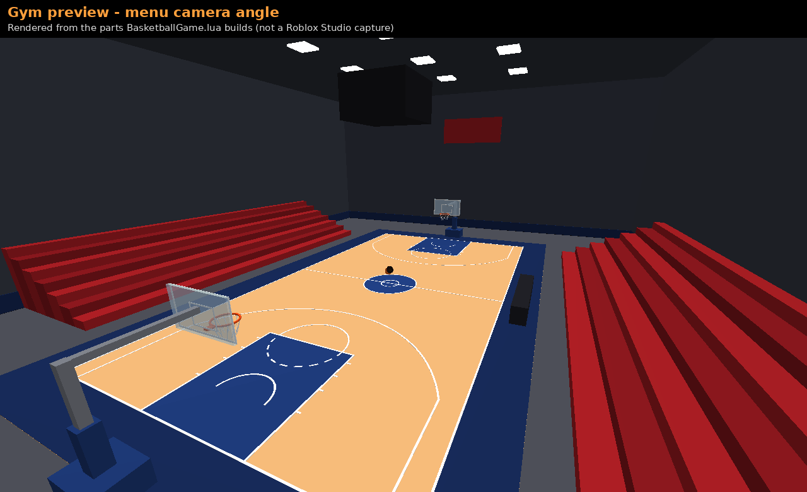
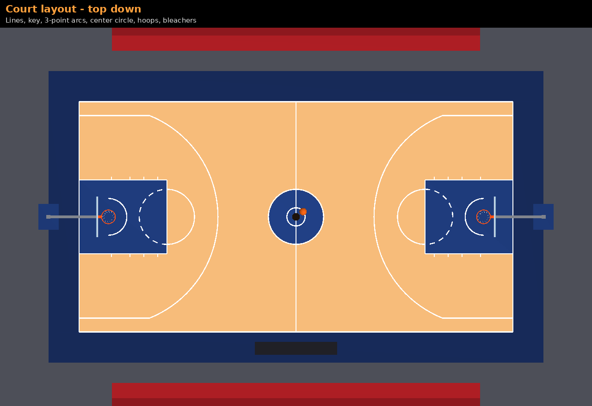
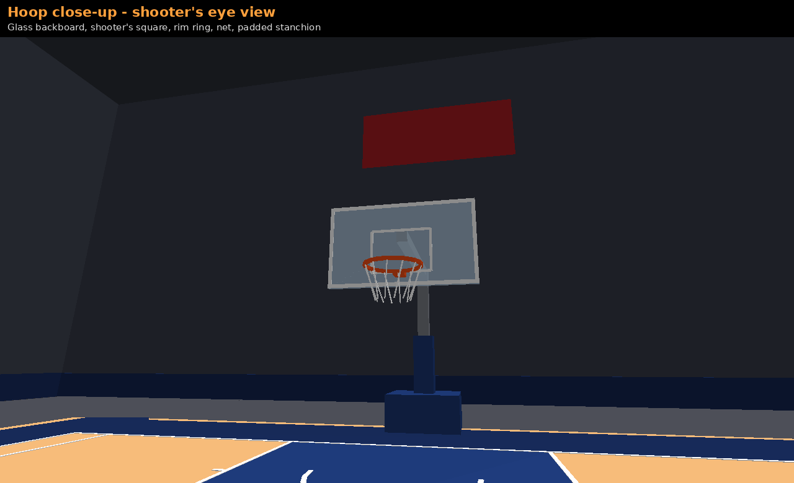
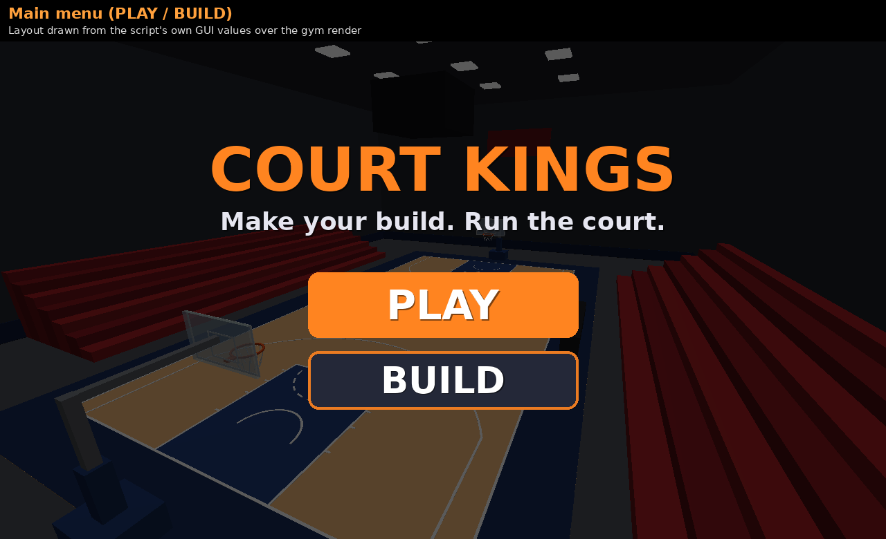
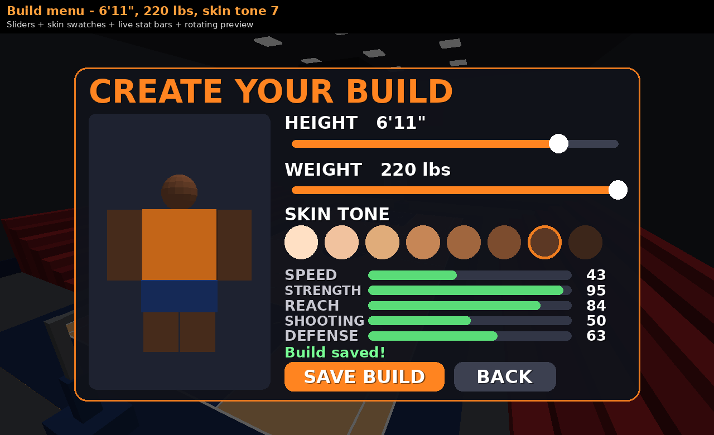
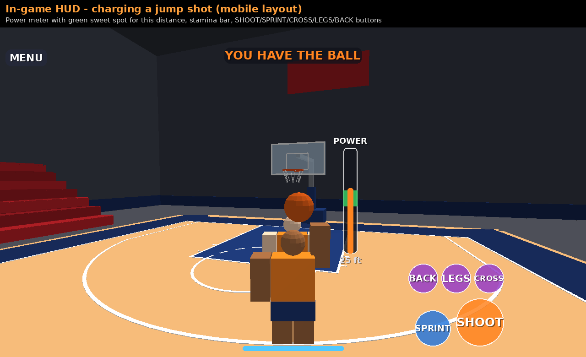
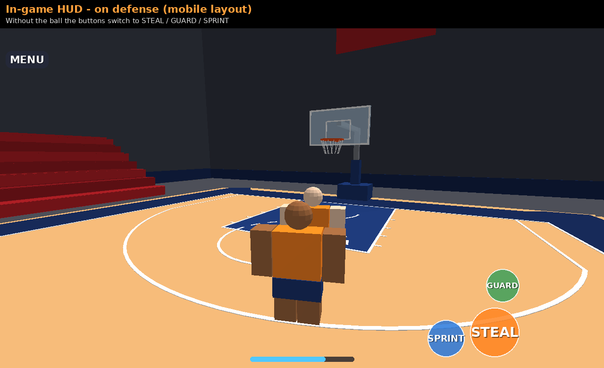
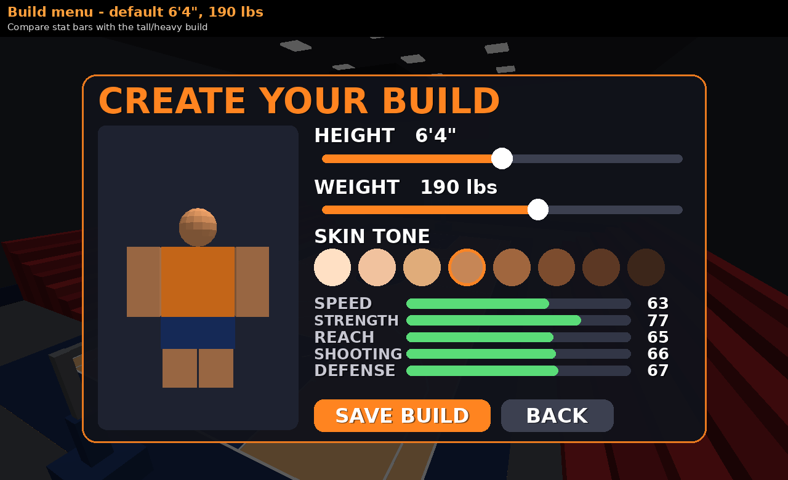

# Court Kings — Roblox basketball (one Luau file)

All of the game is in **`BasketballGame.lua`**: the gym, ball, shooting, dribbling, steals, builds, saving, menus, HUD, mobile buttons, and animation hookup.

## Install in Roblox Studio (about 1 minute)

| # | Where in Studio | What to add | What goes in it |
|---|---|---|---|
| 1 | **ReplicatedStorage** | ModuleScript named `BasketballGame` | Paste all of `BasketballGame.lua` |
| 2 | **ServerScriptService** | Script | `require(game:GetService("ReplicatedStorage"):WaitForChild("BasketballGame")).StartServer()` |
| 3 | **StarterPlayer › StarterPlayerScripts** | LocalScript | `require(game:GetService("ReplicatedStorage"):WaitForChild("BasketballGame")).StartClient()` |

Roblox can't run one script on both the server and each player's device, so steps 2 and 3 are one-line loaders. All of the game code is in the single ModuleScript.

**Studio settings**
- Game Settings › Security › **Enable Studio Access to API Services**: ON. Builds won't save without it.
- Lighting › Technology: **Future** (looks best).
- Optional: Workspace › StreamingEnabled: off. The gym is already set to always load, so you don't have to change this.

## Controls

| Action | PC | Mobile | Gamepad |
|---|---|---|---|
| Sprint | Hold Shift | SPRINT (toggle) | L3 |
| Shoot (with ball) | Hold LMB or F, release | Hold SHOOT, release | R2 |
| Steal (no ball) | LMB or F | STEAL | R2 |
| Guard (no ball) | Hold G | Hold GUARD | L2 |
| Crossover / Between legs / Behind back | Q / E / R | CROSS / LEGS / BACK | X / Y / B |

## How the systems work

- **Pickup:** walk into a loose ball, or grab rebounds. Taller builds can grab higher and from farther away. Only one player can hold the ball, and it's welded to that player while they hold it.
- **Dribble:** the server moves the ball down to the floor and back with a bounce sound. Each of the 3 moves takes the ball on its own path (in front, under the legs, behind the back) and switches it to your other hand.
- **Shooting:** holding the button charges the meter. The green zone shows the right power for your current distance. Your chance to score depends on:
  - how close your charge is to the green zone
  - your distance from the hoop
  - your build: taller players finish better near the rim, shorter players shoot better from deep
  - releasing near the top of your jump
  - defenders guarding you

  Missed shots really hit the rim or backboard and bounce. Shots from behind the arc score 3.
- **Steals:** your chance goes up when the ball is low or mid-move and when you're guarding. It goes down against a stronger (heavier) ball handler. A missed steal slows you for a moment.
- **Builds:**

  | Stat | Effect |
  |---|---|
  | Height (5'5"–7'3") | Body size, reach, rebounding, shooting range |
  | Weight (145–220 lb) | Strength and ball protection, but slower, lower jump, more stamina used |
  | Skin tone | 8 color options |

  Builds are saved with DataStoreService.

## Assets you need to make (placeholders are in the script)

Open the `ANIMATIONS` table near the top of the file. Make each animation **twice**, once on an R15 dummy and once on an R6 dummy (Avatar tab › Rig Builder › Animation Editor). Publish each one, then paste its ID in place of `rbxassetid://0`.

| Animation | Required | Notes |
|---|---|---|
| Shoot | yes | jump shot, ~0.8 s |
| Crossover | yes | ~0.55 s |
| BetweenLegs | yes | ~0.55 s |
| BehindBack | yes | ~0.55 s |
| Sprint | yes | looped |
| SprintWithBall | yes | looped; uses Sprint if missing |
| Dribble, Defense, Steal | optional | extras |

That's 12 required uploads (6 per rig). Until you add them the game still runs: it skips any missing animation and prints a warning in Output.

**Sounds** (`SOUNDS` table):

| Sound | Default |
|---|---|
| Bounce, Swish | Roblox built-in placeholder sounds |
| Rim, Backboard, Steal, Crowd | none; add your own IDs |

**Gym:** built automatically by script. To use your own model instead, set `CONFIG.BuildGym = false`. Your model needs this setup:
- named `BasketballGym`, with a `Hoops` folder
- each hoop has a part named `RimCenter`, its rim parts are named `Rim`, and it has a `Backboard`
- optional: a `Scoreboard` with TextLabels and a `PlayerSpawn` part

## Previews

These are **not Roblox Studio screenshots**. They were rendered from the exact parts and GUI layout the script creates, after running it in a Luau runtime with a mock Roblox API. The blocky players are stand-ins.

| | |
|---|---|
|  |  |
|  |  |
|  |  |
|  |  |
