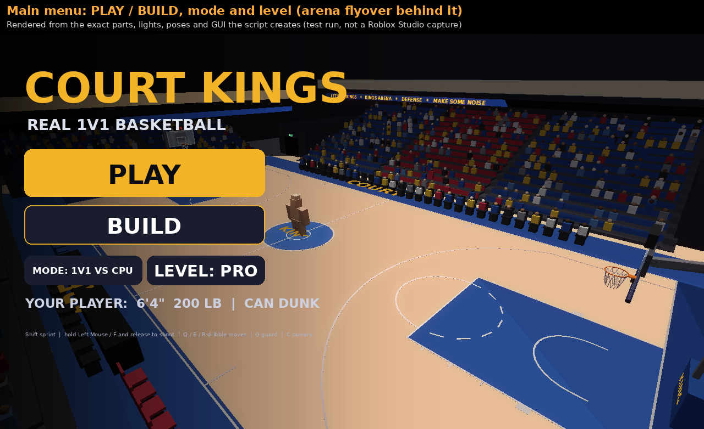
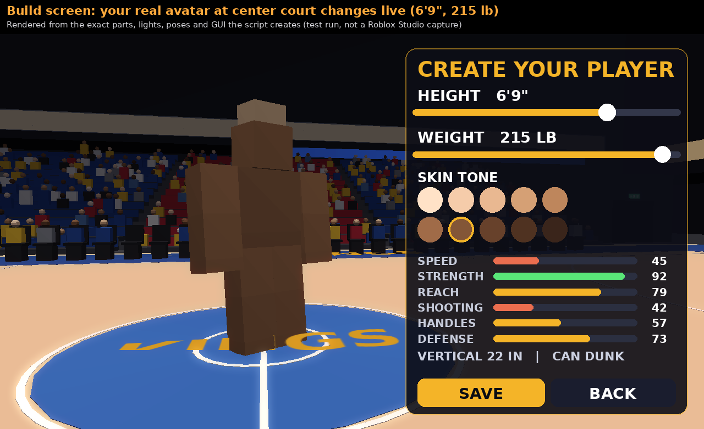
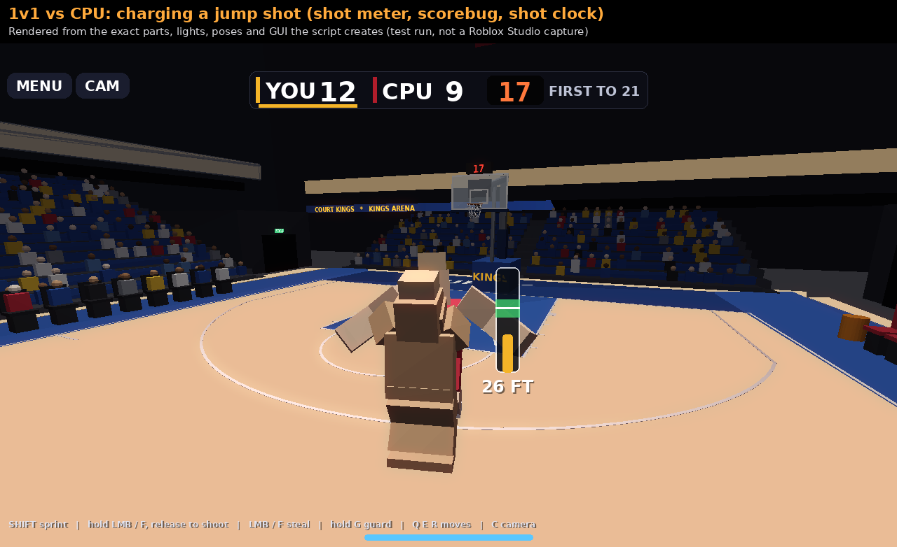
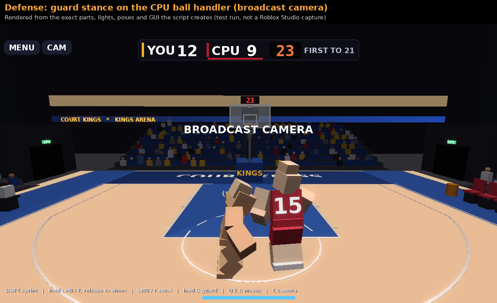
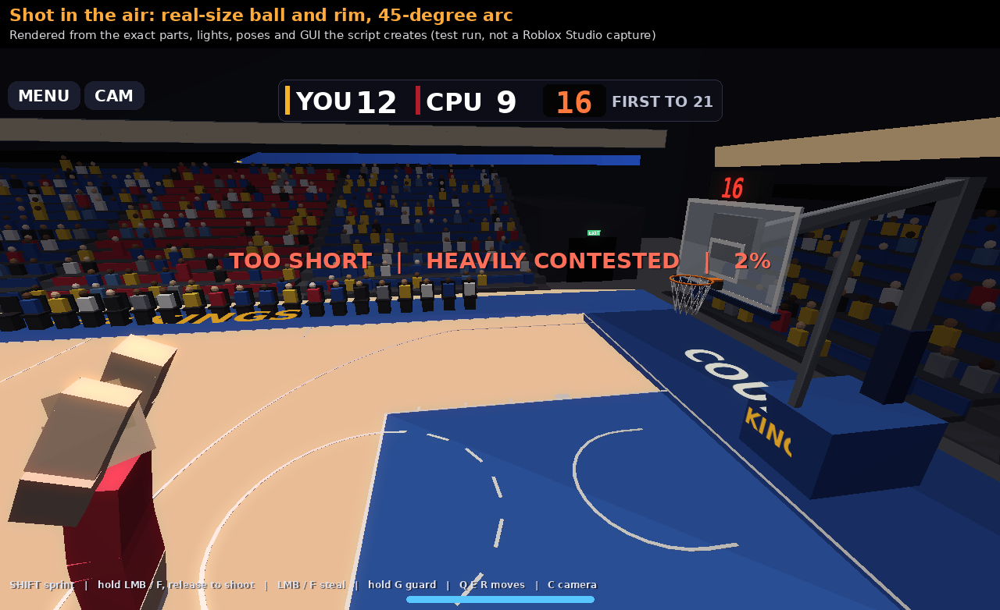
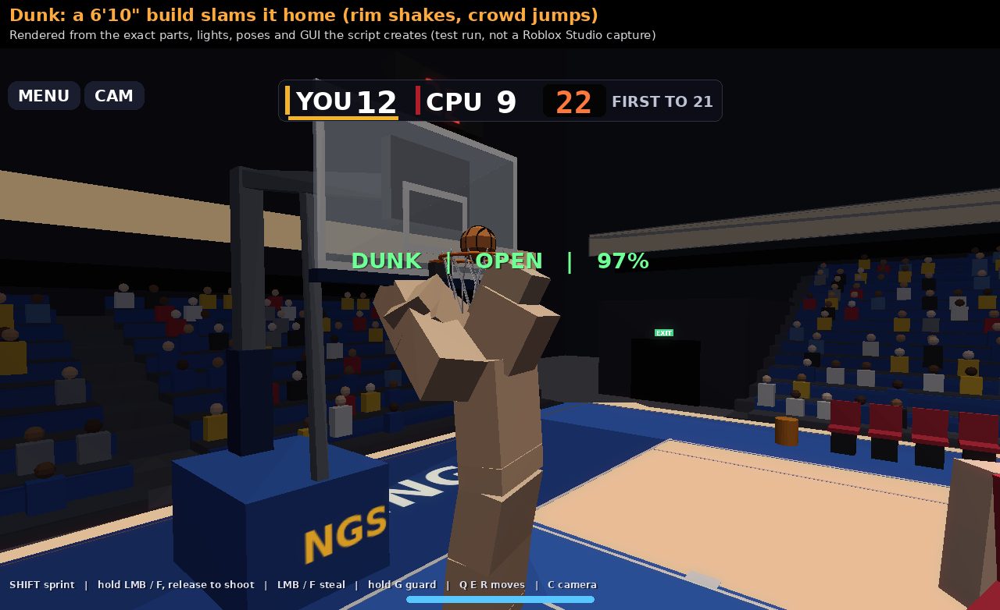
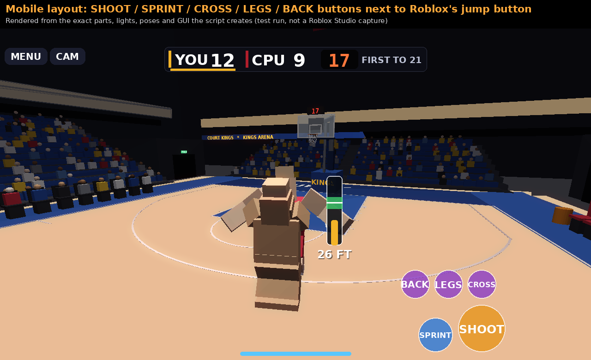
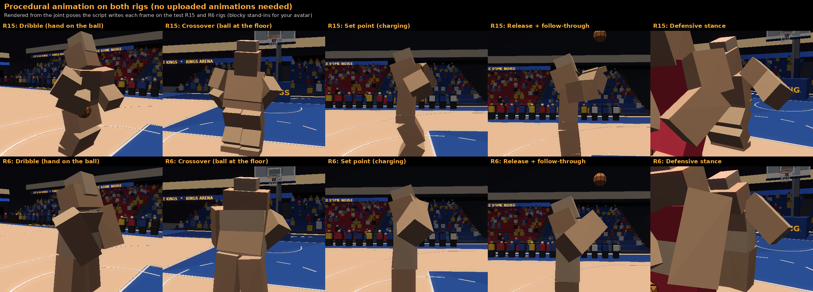

# Court Kings — realistic 1v1 basketball for Roblox (one LocalScript)

The whole game is in one file: **`CourtKings.lua`**.

## Install (one step)

1. In Roblox Studio, open **StarterPlayer › StarterPlayerScripts**.
2. Click **+**, choose **LocalScript**, and paste all of `CourtKings.lua` into it.
3. Press **Play**.

**For the best graphics (1 click, optional):** Explorer › **Lighting** › Properties › **Technology = Future**. Roblox doesn't let scripts change this one setting. The script sets everything else itself, including `LightingStyle = Realistic`, `PrioritizeLightingQuality`, bloom, color grading, haze, depth of field on the menus, and shadow-casting arena lights.

**To save builds forever (optional):** a LocalScript can't use DataStores (Roblox only allows that on the server). Without the server script, your build is kept for the session. To save it permanently:
1. Copy the **OPTIONAL SERVER SAVE SCRIPT** from the bottom of `CourtKings.lua` into a Script in **ServerScriptService**.
2. Turn on **Game Settings › Security › Enable Studio Access to API Services**.

The LocalScript finds the server script automatically.

## Controls

| Action | PC | Mobile | Gamepad |
|---|---|---|---|
| Move / jump | WASD / Space | stick / jump button | left stick / A |
| Sprint | hold Shift | SPRINT (toggle) | L3 (toggle) |
| Shoot (with the ball) | hold Left Mouse or F, release | hold SHOOT, release | R2 |
| Steal (without the ball) | Left Mouse or F | STEAL | R2 |
| Guard stance | hold G | hold GUARD | L2 |
| Crossover / between the legs / behind the back | Q / E / R | CROSS / LEGS / BACK | X / Y / B |
| Camera (player / broadcast) | C | CAM button | D-pad up |

## What's in the game

- **Real-size arena:** 1 foot = 0.9 studs.
  - 94 × 50 ft hardwood court with all the NBA markings: lane, blocks, hash marks, restricted area, the 23'9" three-point line with 22-ft corners, center circle and logo.
  - Glass backboards with a shooter's square and a red LED buzzer strip, 32-segment breakaway rims, and diamond-mesh nets that swish.
  - Padded stanchions, shot clocks above the glass, a center-hung jumbotron with live score, and LED ribbon boards.
  - Seats with a crowd that jumps on big plays, a scorer's table, team benches, courtside seats, championship and retired-number banners, suites, rafters, and spotlights.
- **Real physics:**
  - Real gravity for this scale and a real-size ball (9.4 in) and rim (18 in).
  - Missed shots bounce off the rim and glass, with backspin.
  - Every shot comes in at about a 45° entry angle, like a real jump shot.
  - Dribbles are timed by gravity and the ball's bounce.
- **1v1 vs CPU to 21:**
  - Rules: check ball, 24-second shot clock (14 after an offensive rebound off the rim), take-it-back after defensive rebounds and steals, out of bounds, goaltending.
  - CPU opponents come in 5 archetypes and 3 levels: Rookie / Pro / All-Star. The CPU reacts with a delay, closes out, contests and blocks, pokes at loose dribbles, drives around you, does dribble moves, and predicts rebounds.
- **Shootaround mode:** practice with an automatic rebounder and FG% tracking.
- **Shooting:**
  - **Meter:** a meter floats next to your player. Its green zone shows the right power for your distance.
  - **What decides a make:** your charge accuracy, distance, release timing, how hard you're contested, and your build all count.
  - **Layups and dunks:** layups happen automatically near the rim. Dunks happen if your build can reach the rim.
- **Builds:** height 5'5"–7'3", weight 145–220 lb, and 10 skin tones.
  - They change your real avatar: R15 height and width scaling, R6 overall scale.
  - They also set your ratings: speed, strength, reach, shooting, handles, defense, vertical, and whether you can dunk.
- **Animations for R15 and R6:** built in, with no uploads needed.
  - The script poses your joints every frame on top of Roblox's walk and run.
  - Built-in poses: dribble (the hand stays on the ball), crossover, between the legs, behind the back, set point, release and follow-through, defensive stance, contest, steal, sprint lean, celebration, and your head tracking the ball.
  - Put your own animation IDs in `ANIMATIONS` and they replace the built-in ones.
- **Optimized:**
  - Decorative parts skip collisions, touch, raycasts and shadows.
  - Only the 6 central lights cast shadows.
  - The crowd fills in over a few frames, and crowd animation uses bulk moves.
  - The UI only updates when values change.
  - Everything is client-side, so there's no network lag.

## Things you can change at the top of the file

- **`CONFIG`:**
  - Win score, shot clock, default mode and difficulty.
  - Crowd density, number of shadow lights, real gravity on/off.
  - Hiding other players. Other people in the server play their own copy of the game.
- **`ANIMATIONS`:** your uploaded animation IDs, a separate set for R15 and R6.
- **`SOUNDS`:** sound IDs. Only the bounce sound is built in; the rest are empty until you add IDs.

## How it was tested

I couldn't run Roblox Studio here, so I built a test Roblox in Luau:
- **API checks:** it uses Roblox's current API definitions (Oct 2026). Any unknown property, wrong value type, read-only write, invalid enum or unknown method is an error.
- **Physics:** it simulates characters, jumping, the ball, the rim and the backboard.
- **Joints and animation:** it places joints from their transforms the way Roblox does, including the Animator overwriting joints every frame.

The tests:
- **Full games:** R15, R6 and touch, with an automated player driving the menus, Build screen, a full 1v1 game, shootaround, the camera toggle, a reset/respawn, and pressing Play before your avatar spawns. Result: **0 errors, 0 warnings.**
- **Forced makes:** 30 shots from 2 to 30 feet with the make forced, on each rig. All 30 went through the rim.
- **Make detection:** on normal shots, every shot that rolled a make went in.

The screenshots below are renders of the exact parts, lights, joint poses and GUI the script creates in that test run. They are not Roblox Studio captures. The blocky players are the test rigs standing in for your avatar.

## Screenshots

| | |
|---|---|
|  |  |
|  |  |
|  |  |
|  | |

